<div align="center">

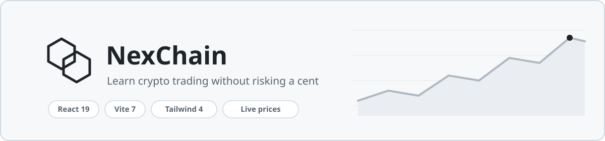

<br>


**[Screens](#-screens)** &nbsp;·&nbsp; **[Quick start](#-quick-start)** &nbsp;·&nbsp; **[Architecture](#-architecture)** &nbsp;·&nbsp; **[Pages](#-pages)** &nbsp;·&nbsp; **[Conventions](#-conventions)** &nbsp;·&nbsp; **[Deploy](#-deploying-to-vercel)**

<sub>Backend → <a href="https://github.com/Arjunsathia/NexChain-backend"><b>NexChain API</b></a></sub>

</div>

<br>

## ◆ Overview

NexChain is a crypto **paper-trading** app. Sign up, or just press **Try the demo**, and you get a **$10,000 virtual wallet**. Trade it against **live Binance prices** with real order types, and see how you'd really do, without risking a cent.

This repository is the web app: a React single-page app that talks to the [NexChain API](https://github.com/Arjunsathia/NexChain-backend) and streams prices straight from Binance.

<p align="center">
  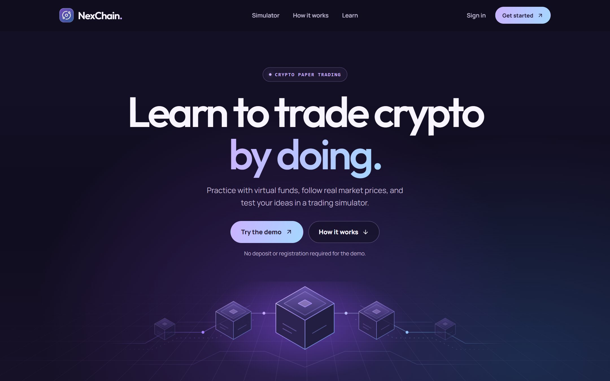
</p>

<table width="100%">
<tr>
<td width="50%" valign="top">

#### Trading

- Live market of about 30 coins with highlights and quick view
- Coin pages: line and candle charts, order book, recent trades
- Market, limit, stop-limit, stop-market and **OCO** orders
- Portfolio: holdings, allocation, performance, open orders, history
- Instant toasts when orders fill or alerts fire
- Watchlist, leaderboard and news

</td>
<td width="50%" valign="top">

#### Everything around it

- AI assistant that can look up live prices and news
- Learning hub, readable signed in or out
- Email + OTP, Google sign-in, 2FA, KYC, profile settings
- One-click **demo account**, no sign-up
- Admin console: users, coins, feedback, security
- Light and dark themes, phone layout with a bottom tab bar

</td>
</tr>
</table>

<br>

## ◆ Screens

<table>
<tr>
<td width="50%">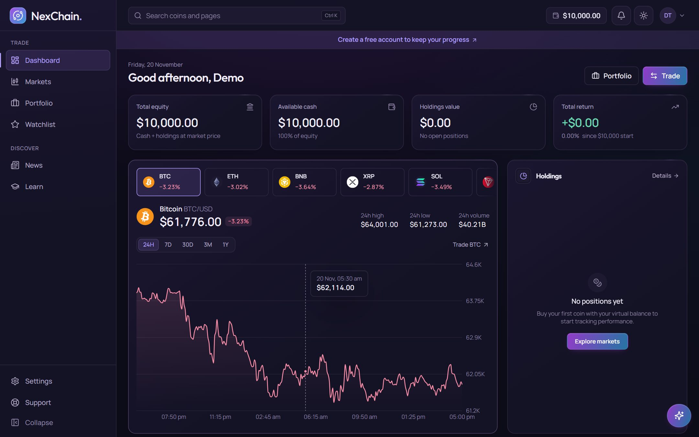<p align="center"><sub><b>Dashboard</b> · equity, cash, live chart, holdings</sub></p></td>
<td width="50%">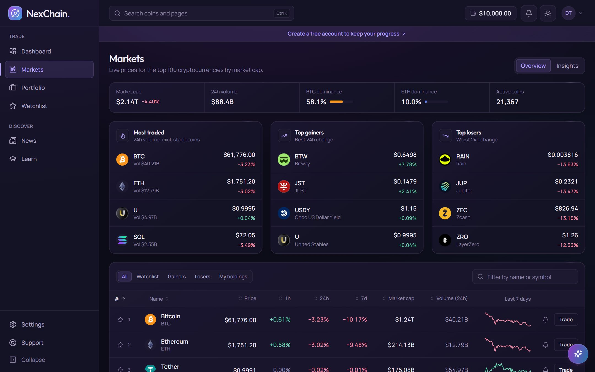<p align="center"><sub><b>Markets</b> · top 100, movers, 7-day sparklines</sub></p></td>
</tr>
<tr>
<td width="50%">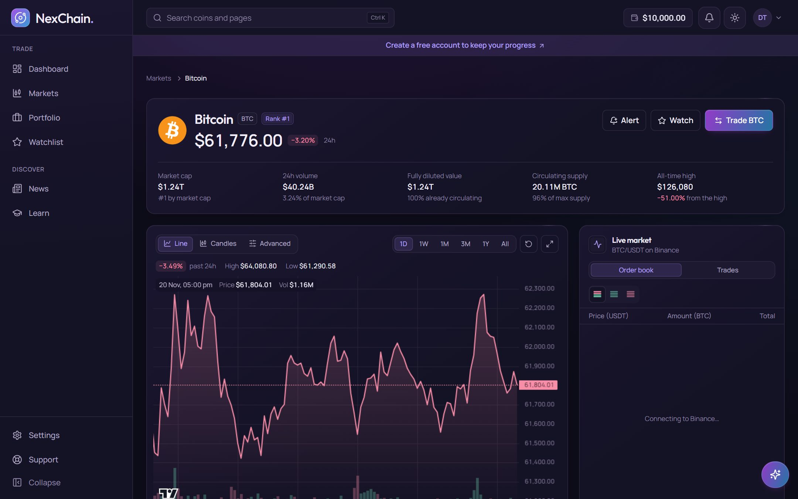<p align="center"><sub><b>Coin details</b> · chart, stats, live order book</sub></p></td>
<td width="50%">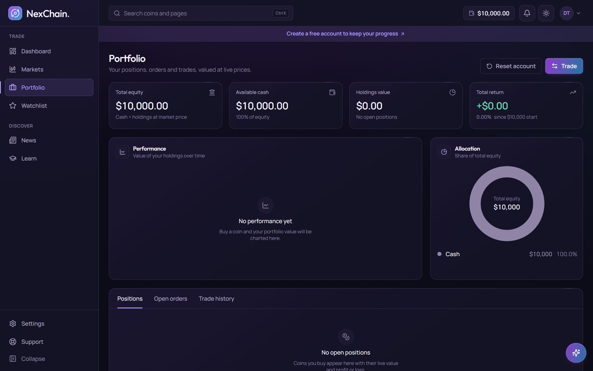<p align="center"><sub><b>Portfolio</b> · performance, allocation, orders, history</sub></p></td>
</tr>
</table>

<p align="center">
  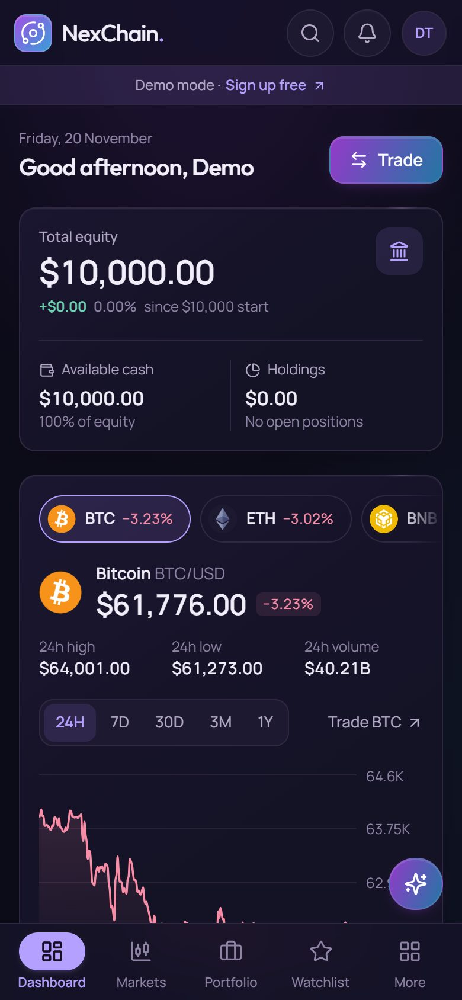
  &nbsp;&nbsp;&nbsp;
  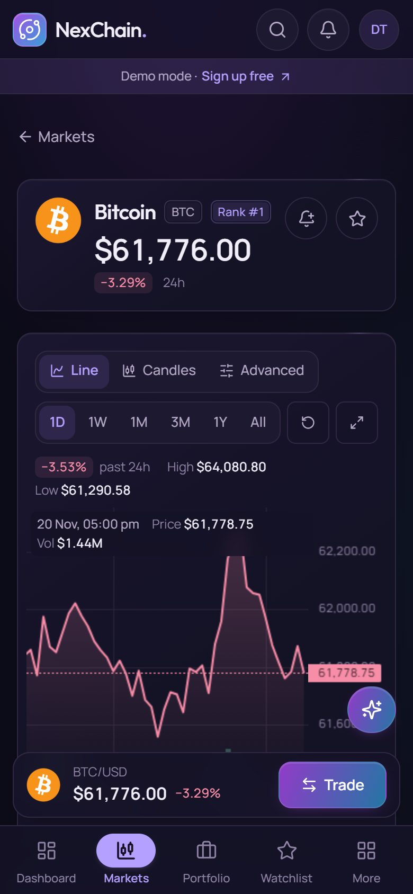
  <br>
  <sub><b>On a phone</b> · bottom tab bar, large tap targets, sticky trade bar</sub>
</p>

<details>
<summary><b>Contents</b></summary>
<br>

| | | |
|---|---|---|
| [Screens](#-screens) | [Pages](#-pages) | [Project structure](#-project-structure) |
| [Quick start](#-quick-start) | [Configuration](#-configuration) | [Conventions](#-conventions) |
| [Architecture](#-architecture) | [Scripts](#-scripts) | [Deploying to Vercel](#-deploying-to-vercel) |
| [Limits and next steps](#-limits-and-next-steps) | | |

</details>

<br>

## ◆ Quick start

> [!NOTE]
> **Requirements:** Node.js 20 or newer, and the [API](https://github.com/Arjunsathia/NexChain-backend) running locally.

```bash
# 1 · in NexChain-backend
npm run dev                # API on http://localhost:4001, with its own database

# 2 · here
npm install
cp .env.example .env       # defaults already point at the local API
npm run dev                # → http://localhost:5173
```

<table>
<tr>
<td width="50%" valign="top">

**Sign in** with a seeded account (password `Password123`), or press **Try the demo**:

| Username | Sees |
|---|---|
| `testuser` | the trading app |
| `admin`, `superadmin` | the app plus the admin console |

</td>
<td width="50%" valign="top">

**Test on your phone:** the dev server listens on your network (`vite --host`). Open the "Network" address it prints on any device on the same Wi-Fi.

</td>
</tr>
</table>

<br>

## ◆ Architecture

### The big picture

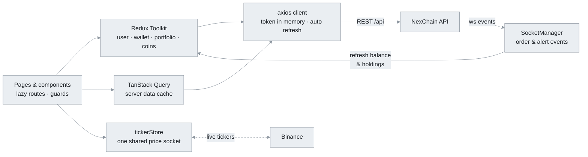

### Component tree

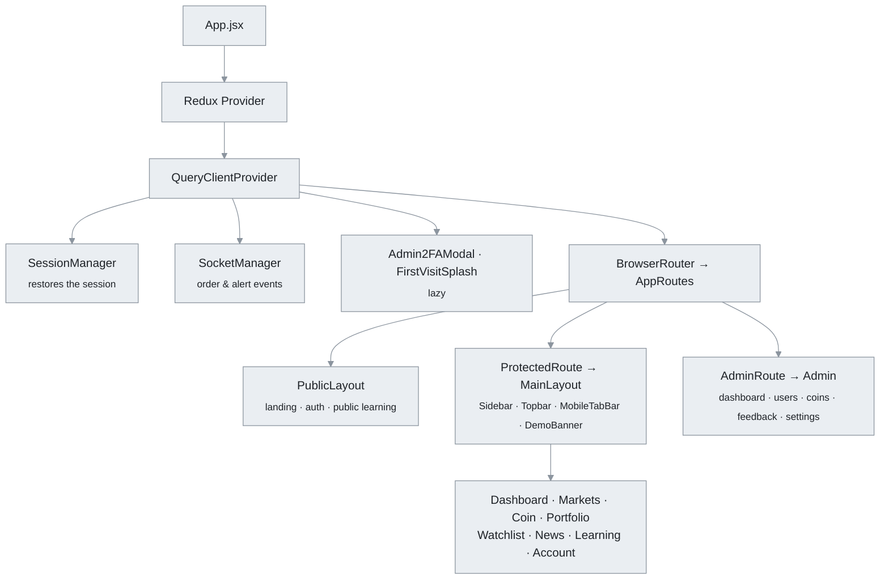

### Where state lives

| Kind of state | Owner | Notes |
|---|---|---|
| **Signed-in user, balance, holdings** | Redux Toolkit (`src/redux/slices/`) | `user`, `wallet`, `portfolio`, `coins` slices. Refreshed by socket events after fills |
| **Server data** (lists, news, orders…) | TanStack Query | 5-minute stale time, one retry, no refetch on window focus |
| **Live prices** | `src/lib/tickerStore.js` | Outside React. Components subscribe through hooks |
| **Access token** | Memory only (`src/api/axiosConfig.js`) | Never in `localStorage` |
| **Theme, visited routes** | `utils/theme-manager.js`, `VisitedRoutesContext` | UI preferences |

### Session restore

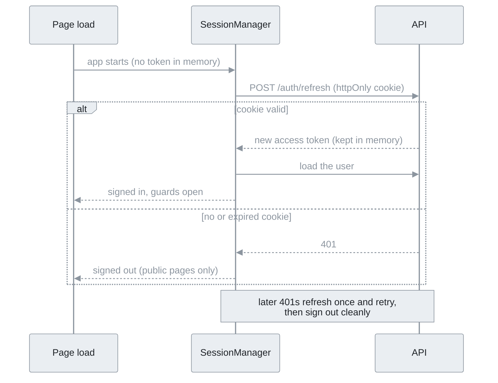

### Live prices

```mermaid
%%{init: {"theme":"base","themeVariables":{"primaryColor":"#eaeef2","primaryTextColor":"#1f2328","primaryBorderColor":"#8c959f","secondaryColor":"#eaeef2","tertiaryColor":"#f6f8fa","lineColor":"#8c959f","textColor":"#57606a","edgeLabelBackground":"#eaeef2","clusterBkg":"#f6f8fa","clusterBorder":"#d0d7de","titleColor":"#57606a","signalColor":"#8c959f","signalTextColor":"#8c959f","actorBkg":"#eaeef2","actorBorder":"#8c959f","actorTextColor":"#1f2328","actorLineColor":"#8c959f","noteBkgColor":"#eaeef2","noteTextColor":"#1f2328","noteBorderColor":"#8c959f","labelBoxBkgColor":"#eaeef2","labelBoxBorderColor":"#8c959f","labelTextColor":"#1f2328","loopTextColor":"#8c959f","sequenceNumberColor":"#ffffff"}}}%%
flowchart LR
    subgraph H["Components, through hooks"]
        direction TB
        C1["useLivePrice('bitcoin')"]
        C2["useLivePrice('ethereum')"]
        C3["useBinanceTicker()"]
    end
    TS["tickerStore<br/>batches updates every 1 s"]
    BN["Binance"]
    H -- "subscribe" --> TS
    TS <-. "one socket, open only<br/>while someone subscribes" .-> BN
    TS -. "notify only the listeners<br/>whose coin changed" .-> H
```

A page showing one coin re-renders only when **that** coin moves. The socket closes when nothing is listening.

### A trade, start to finish

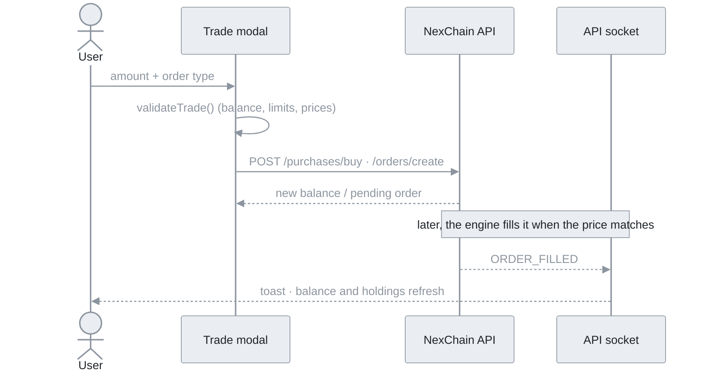

### Slow first request

The API host can sleep after about 15 idle minutes and take up to a minute to wake. `src/api/serverWake.js` watches requests. If one is still pending after 4 s and the server hasn't answered recently, it shows a single "waking up the server" notice, so a slow first click doesn't look broken.

<br>

## ◆ Pages

| Area | Routes |
|---|---|
| **Public** | `/` landing · `/auth` · `/reset-password` · `/public-learning` and `/public-learning/:slug` |
| **Trading** 🔒 | `/dashboard` · `/cryptolist` · `/coin/coin-details/:coinId` · `/portfolio` · `/watchlist` · `/news` |
| **Learning** 🔒 | `/learning` · `/learning/:slug` |
| **Account** 🔒 | `/user-profile/:userId` · `/user/settings` · `/user/support` · `/user/insights` |
| **Admin** 🛡 | `/admin/dashboard` · `/admin/users` · `/admin/cryptocurrencies` · `/admin/feedback` · `/admin/settings` |

🔒 signed in (`ProtectedRoute`) &nbsp;·&nbsp; 🛡 admin role (`AdminRoute`). Every page is lazy-loaded.

<br>

## ◆ Configuration

Copy `.env.example` to `.env`.

| Variable | Purpose |
|---|---|
| `VITE_API_BASE_URL` | API base URL, ending in `/api` (e.g. `http://localhost:4001/api`) |
| `VITE_WS_URL` | API WebSocket for order and alert events. Optional: derived from the API URL |
| `VITE_BINANCE_WS_URL` | Binance stream host. Optional: defaults to `wss://data-stream.binance.vision`, which also works where binance.com is blocked |
| `VITE_BINANCE_REST_URL` | Binance REST host for charts (`https://data-api.binance.vision` allows browser requests) |
| `VITE_GOOGLE_CLIENT_ID` | Google OAuth client id. Must equal the API's `GOOGLE_CLIENT_ID` |

> [!CAUTION]
> `VITE_*` values are **built into the bundle**, and anyone can read them in the browser. **Never put secrets here.** Restart `npm run dev` (or rebuild) after changing them.

<br>

## ◆ Scripts

| Command | What it does |
|---|---|
| `npm run dev` | Dev server with hot reload, reachable on your network |
| `npm run build` | Production build into `dist/` |
| `npm run preview` | Serve the production build locally |
| `npm test` | Vitest: session handling, route guards, trade validation, formatting, the server-wake notice |
| `npm run lint` | ESLint |

**CI** runs lint, tests and a production build on every push and pull request. The build runs on Linux, so it also catches import-path casing mistakes that Windows ignores.

<br>

## ◆ Project structure

```text
src/
├── App.jsx              providers, session and socket managers
├── Routes/              AppRoutes + route guards
├── Pages/               one file or folder per page (Admin/, CoinDetails/, UserProfile/…)
├── Components/
│   ├── ui/              design-system primitives (button, card, modal, sheet, table…)
│   ├── layout/          MainLayout, Sidebar, Topbar, MobileTabBar, MoreSheet, search
│   ├── Common/          session/socket managers, chatbot, modals, error boundary
│   ├── TradeModal/      trade form + validateTrade
│   └── …                portfolio, Crypto, CoinDetails, Dashboard, Watchlist, Settings, Admin, Landing
├── hooks/               useLivePrice, useBinanceTicker, useSocket, useLogout, useDemoLogin…
├── redux/               store + slices
├── api/                 axios config (token, refresh), coin APIs, server-wake notice
├── lib/tickerStore.js   shared live price socket
├── utils/               format, coinRegistry, avatar, safeUrl, theme-manager…
├── content/             learning guides, support FAQs
├── design-system.css    tokens: sizes, layers, motion
└── __tests__/           Vitest suites
```

<br>

## ◆ Conventions

<table>
<tr><th align="left" width="24%">Topic</th><th align="left">Rule</th></tr>
<tr><td><b>Tokens</b></td><td>Keep them in memory only. Never store tokens or user objects in <code>localStorage</code>. Log out with <code>useLogout</code>.</td></tr>
<tr><td><b>Route guards</b></td><td>They decide what to show, nothing more. The API enforces every rule itself.</td></tr>
<tr><td><b>Live prices</b></td><td>Use <code>useLivePrice(coinId)</code> for one coin and <code>useBinanceTicker()</code> for all. Never open your own Binance socket. The coin id → pair mapping is in <code>src/utils/coinRegistry.js</code>.</td></tr>
<tr><td><b>First load</b></td><td>Pages are lazy-loaded. Keep heavy libraries (charts, motion) out of <code>App.jsx</code> and the layouts.</td></tr>
<tr><td><b>Demo users</b></td><td><code>user.isDemo</code> drives the <code>DemoBanner</code> and the locked fields in Settings. "Try the demo" calls <code>useDemoLogin()</code>.</td></tr>
<tr><td><b>Theme</b></td><td><code>dark:</code> classes follow the app's toggle (the <code>.dark</code> class), configured in <code>src/index.css</code>. Tailwind 4 has no <code>tailwind.config.js</code>.</td></tr>
<tr><td><b>Phones</b></td><td>Use the design tokens (<code>--control-h-touch</code> = 44 px tap target) and <code>ui/motion.js</code> for sheets and modals. <code>useKeyboardInset</code> keeps inputs above the keyboard. <code>useScrollRows</code> scrolls the selected tab into view.</td></tr>
<tr><td><b>Helpers</b></td><td><code>utils/format.js</code> handles currency, compact numbers and relative time. <code>utils/avatar.js</code> builds avatars. Always pass third-party links through <code>utils/safeUrl.js</code>.</td></tr>
</table>

<br>

## ◆ Deploying to Vercel

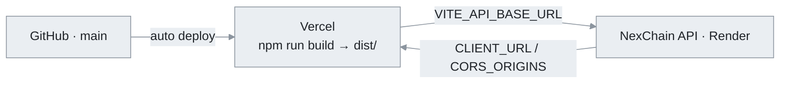

1. **Import the repo** into Vercel. Vite is detected automatically.
2. **Set the `VITE_*` variables:** the Render API URL and the production Google client id.
3. **Allow the origin:** add the Vercel URL to the API's `CLIENT_URL` / `CORS_ORIGINS`.

`vercel.json` takes care of hosting:

- serves the SPA (static files like `robots.txt` and the icons are served as-is)
- caches hashed assets for a year
- sets security headers: `nosniff`, no framing, strict referrer, and no camera, microphone or location access

<br>

## ◆ Limits and next steps

| Today | Next step |
|---|---|
| The first request after a quiet spell can be slow while the API host wakes (handled with a notice) | Keep the API on an always-on plan for production traffic |
| Live prices for display come straight from Binance, so some networks may block them | The default host already works in most regions; it's configurable with `VITE_BINANCE_WS_URL` |
| Tests cover sessions, guards, validation and helpers | Add end-to-end tests for the main trading flows |

<br>

<div align="center">
<sub><b>NexChain</b> &nbsp;·&nbsp; <a href="https://github.com/Arjunsathia/NexChain-FE">Frontend</a> &nbsp;·&nbsp; <a href="https://github.com/Arjunsathia/NexChain-backend">Backend</a></sub>
</div>
