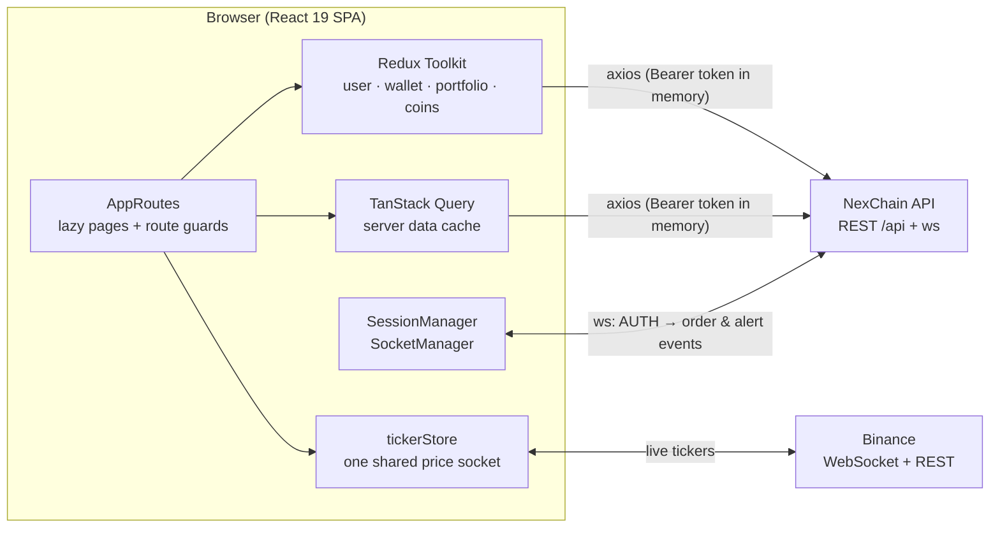
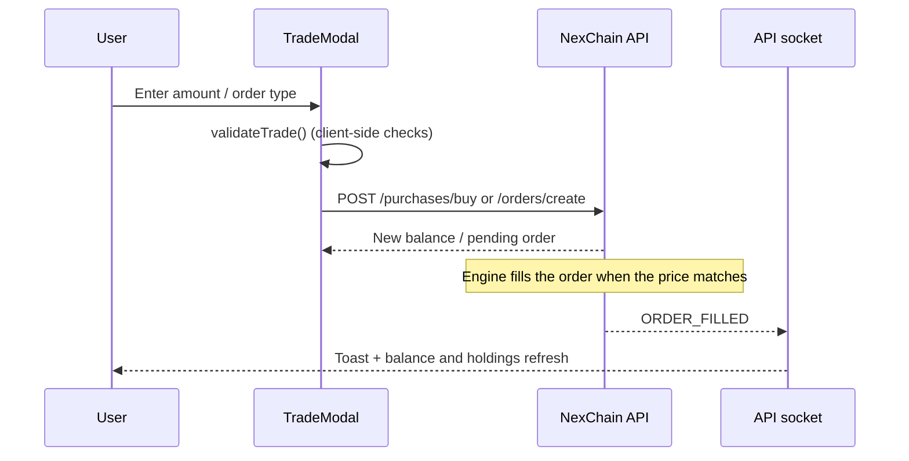

<div align="center">

# ⚡ NexChain

**Learn crypto trading without risking a cent.**
A paper-trading app with live Binance prices, a $10,000 virtual wallet, real order types and a full admin console.


[Quick start](#-quick-start) · [Architecture](#-architecture) · [Pages](#-pages) · [Conventions](#-conventions-for-contributors) · [Deploying](#-deploying-vercel)

Backend: [NexChain API](../NexChain-backend)

</div>

---

## ✨ Features

- 📈 **Live market.** About 30 coins streamed straight from Binance, with highlights, a day range and a quick view.
- 🪙 **Coin pages.** Candlestick charts, an order book, recent trades and a trade panel.
- 🎯 **Real order types.** Market, limit, stop-limit, stop-market and OCO orders, all checked before they're sent.
- 💼 **Portfolio.** Holdings, allocation, a performance chart, open orders (editable) and full transaction history.
- 🔔 **Instant updates.** Order fills and price alerts arrive over the API's WebSocket as toasts and notifications.
- 🏆 **Leaderboard, watchlist and news.**
- 🤖 **AI assistant.** Gemini-powered chat that can look up live prices and news.
- 📚 **Learning hub.** Built-in guides, readable while signed out too.
- 🧪 **One-click demo.** A private sandbox account, no sign-up needed.
- 🔐 **Accounts.** Email + OTP, Google sign-in, password reset, 2FA, KYC and profile settings.
- 🛡 **Admin console.** Dashboard, users, coin freezes, feedback, security settings.
- 🌗 **Light and dark themes**, plus a phone layout with a bottom tab bar.

---

## 🚀 Quick start

> **You need:** Node.js 20+ and the [API](../NexChain-backend) running locally.

```bash
# 1. In NexChain-backend
npm run dev                # API on http://localhost:4001 (brings its own database)

# 2. Here
npm install
cp .env.example .env       # the defaults already point at the local API
npm run dev                # → http://localhost:5173
```

Sign in with a seeded account (`testuser` / `Password123`, or `admin` / `superadmin` for the console), or just press **Try the demo**.

`npm run dev` listens on your network (`vite --host`), so you can open the app from a phone on the same Wi-Fi.

---

## 🏗 Architecture



### How the pieces fit

| Concern | Where | Notes |
|---|---|---|
| **App shell** | `src/App.jsx` | Redux and Query providers, `SessionManager`, `SocketManager`, and the admin 2FA modal |
| **Routing** | `src/Routes/AppRoutes.jsx` | Every page is lazy-loaded. Guards: `ProtectedRoute`, `AdminRoute`, `AuthRoute` |
| **Session** | `src/api/axiosConfig.js`, `SessionManager` | The access token lives **only in memory**. On load, the session is restored from the API's httpOnly refresh cookie |
| **Global state** | `src/redux/slices/` | `user`, `wallet` (balance), `portfolio` (holdings, transactions), `coins` |
| **Server data** | TanStack Query | 5-minute stale time, one retry, no refetch on window focus |
| **Live prices** | `src/lib/tickerStore.js` | One Binance socket, opened only while something subscribes. Updates are batched each second, and each listener hears only about its own coin |
| **Real-time events** | `src/hooks/useSocket.js` | Authenticates with the first message, then refreshes the balance and holdings on fills and alerts |
| **Slow first request** | `src/api/serverWake.js` | Render sleeps after ~15 idle minutes. When a request is slow and the server may be asleep, shows one "waking up the server" notice |
| **Design system** | `src/design-system.css`, `src/Components/ui/` | Tokens for sizes, layers and motion, plus shared primitives (button, card, modal, sheet, table…) |

### Request flow for a trade



---

## 🧭 Pages

| Area | Routes |
|---|---|
| **Public** | `/` landing · `/auth` sign in and sign up · `/reset-password` · `/public-learning` (+ `/:slug`) |
| **Trading** 🔒 | `/dashboard` · `/cryptolist` · `/coin/coin-details/:coinId` · `/portfolio` · `/watchlist` · `/news` |
| **Learning** 🔒 | `/learning` · `/learning/:slug` |
| **Account** 🔒 | `/user-profile/:userId` · `/user/settings` · `/user/support` · `/user/insights` |
| **Admin** 🛡 | `/admin/dashboard` · `/admin/users` · `/admin/cryptocurrencies` · `/admin/feedback` · `/admin/settings` |

---

## ⚙️ Configuration

Copy `.env.example` to `.env`.

| Variable | Purpose |
|---|---|
| `VITE_API_BASE_URL` | API base URL, ending in `/api` (e.g. `http://localhost:4001/api`) |
| `VITE_WS_URL` | API WebSocket for order and alert events. Optional: derived from the API URL |
| `VITE_BINANCE_WS_URL` | Binance stream host. Optional: defaults to `wss://data-stream.binance.vision`, which also works where binance.com is blocked |
| `VITE_BINANCE_REST_URL` | Binance REST host for charts (`https://data-api.binance.vision` allows browser requests) |
| `VITE_GOOGLE_CLIENT_ID` | Google OAuth client id. Must equal the API's `GOOGLE_CLIENT_ID` |

> [!NOTE]
> `VITE_*` values are **baked into the build**. Restart `npm run dev` (or rebuild) after changing them, and **never put secrets here**: anyone can read them in the browser.

---

## 🧰 Scripts

| Command | What it does |
|---|---|
| `npm run dev` | Dev server with hot reload, reachable on your network |
| `npm run build` | Production build into `dist/` |
| `npm run preview` | Serve the production build locally |
| `npm test` | Vitest: session handling, route guards, trade validation, formatting, the server-wake notice |
| `npm run lint` | ESLint |

CI (`.github/workflows/ci.yml`) runs lint, tests and a build on every push and pull request. The build runs on Linux, so it also catches import-path casing mistakes that Windows ignores.

---

## 📁 Project structure

```
src/
├── App.jsx                # providers, session and socket managers
├── Routes/                # AppRoutes + route guards
├── Pages/                 # one file or folder per page (Admin/, CoinDetails/, UserProfile/…)
├── Components/
│   ├── ui/                # design-system primitives
│   ├── layout/            # MainLayout, Sidebar, Topbar, MobileTabBar, MoreSheet, search
│   ├── Common/            # session/socket managers, chatbot, modals, error boundary
│   ├── TradeModal/        # trade form + validateTrade
│   ├── portfolio/ Crypto/ CoinDetails/ Dashboard/ Watchlist/ Settings/ Admin/ Landing/
├── hooks/                 # useLivePrice, useBinanceTicker, useSocket, useLogout, useDemoLogin…
├── redux/                 # store + slices
├── api/                   # axios config (token, refresh), coin APIs, server-wake notice
├── lib/tickerStore.js     # shared live price socket
├── utils/                 # format, coinRegistry, avatar, safeUrl, theme-manager…
├── content/               # learning guides, support FAQs
└── __tests__/             # Vitest suites
```

---

## 🤝 Conventions for contributors

- **🔑 Tokens stay in memory.** Never store tokens or user objects in `localStorage`. Log out with the `useLogout` hook.
- **🛡 Guards are UI only.** `ProtectedRoute`, `AdminRoute` and `AuthRoute` decide what to show. The API enforces every rule itself.
- **📡 Live prices:**
  - `useLivePrice(coinId)` for one coin. It re-renders only when that coin changes.
  - `useBinanceTicker()` for all coins.
  - Don't open your own Binance socket. The mapping from coin id to Binance pair lives in `src/utils/coinRegistry.js`.
- **⚡ Keep the first load small.** Pages are lazy-loaded. Keep heavy libraries (charts, motion) out of `App.jsx` and the layouts.
- **🧪 Demo users.** `user.isDemo` drives the `DemoBanner` and the locked fields in Settings. "Try the demo" calls `useDemoLogin()`.
- **🌗 Theme.** `dark:` classes follow the app's own toggle (the `.dark` class), configured in `src/index.css`. Tailwind 4 has no `tailwind.config.js`.
- **📱 Phones.**
  - Use the design tokens (`--control-h-touch` is the 44 px tap target) and the shared `ui/motion.js` for sheets and modals.
  - `useKeyboardInset` keeps inputs above the on-screen keyboard.
  - `useScrollRows` scrolls the selected tab or chip into view.
- **🧩 Shared helpers.**
  - `utils/format.js`: currency, compact numbers, relative time.
  - `utils/avatar.js`: user avatars.
  - `utils/safeUrl.js`: always use it for third-party links.

---

## ☁️ Deploying (Vercel)

1. Import the repo into Vercel. Vite is detected automatically (`npm run build` → `dist/`).
2. Set the `VITE_*` variables: the Render API URL and the production Google client id.
3. Add the Vercel URL to the API's `CLIENT_URL` / `CORS_ORIGINS`.

`vercel.json` serves the SPA (static files like `robots.txt` and the icons are served as-is), caches hashed assets for a year, and sets basic security headers (`nosniff`, `DENY` framing, strict referrer, no camera, microphone or location).
