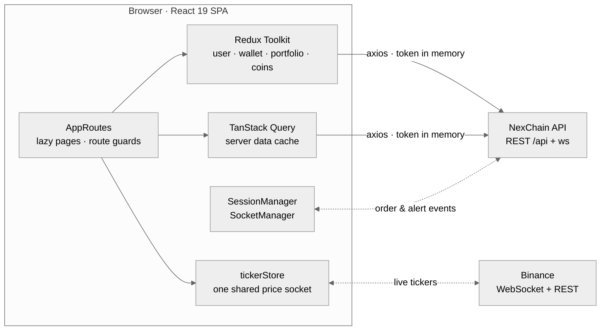
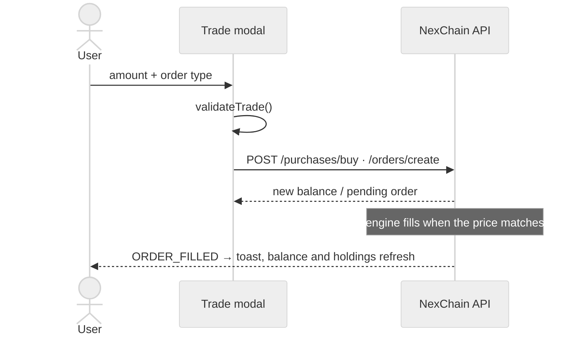

<div align="center">


<br>


**[Quick start](#quick-start)** &nbsp;·&nbsp; **[Architecture](#architecture)** &nbsp;·&nbsp; **[Pages](#pages)** &nbsp;·&nbsp; **[Configuration](#configuration)** &nbsp;·&nbsp; **[Conventions](#conventions)** &nbsp;·&nbsp; **[Deploy](#deploying-to-vercel)**

<sub>Backend lives in <a href="https://github.com/Arjunsathia/NexChain-backend">NexChain API</a></sub>

</div>

<br>

## Overview

NexChain is a crypto **paper-trading** app. Sign up, or press **Try the demo**, and get a **$10,000 virtual wallet**. Trade it against **live Binance prices** with real order types, and see how you'd really do, without risking a cent.

This repository is the web app: a React single-page app that talks to the [NexChain API](https://github.com/Arjunsathia/NexChain-backend) and streams prices straight from Binance.

<table>
<tr>
<td width="50%" valign="top">

**Trading**

- Live market of about 30 coins with highlights and quick view
- Coin pages: candlestick chart, order book, recent trades
- Market, limit, stop-limit, stop-market and **OCO** orders
- Portfolio: holdings, allocation, performance, open orders, history
- Instant toasts when orders fill or alerts fire
- Watchlist, leaderboard and news

</td>
<td width="50%" valign="top">

**Everything around it**

- AI assistant that can look up live prices and news
- Learning hub, readable signed in or out
- Email + OTP, Google sign-in, 2FA, KYC, profile settings
- One-click **demo account**, no sign-up
- Admin console: users, coins, feedback, security
- Light and dark themes, phone layout with a bottom tab bar

</td>
</tr>
</table>

<br>

## Contents

1. [Quick start](#quick-start)
2. [Architecture](#architecture)
3. [Pages](#pages)
4. [Configuration](#configuration)
5. [Scripts](#scripts)
6. [Project structure](#project-structure)
7. [Conventions](#conventions)
8. [Deploying to Vercel](#deploying-to-vercel)

<br>

## Quick start

> **Requirements:** Node.js 20 or newer, and the [API](https://github.com/Arjunsathia/NexChain-backend) running locally.

```bash
# 1 · in NexChain-backend
npm run dev                # API on http://localhost:4001, with its own database

# 2 · here
npm install
cp .env.example .env       # defaults already point at the local API
npm run dev                # → http://localhost:5173
```

**Sign in** with a seeded account (password `Password123`), or press **Try the demo**:

| Username | Sees |
|---|---|
| `testuser` | the trading app |
| `admin`, `superadmin` | the trading app plus the admin console |

The dev server listens on your network (`vite --host`), so you can open the app on a phone on the same Wi-Fi.

<br>

## Architecture



### How the pieces fit

| Concern | Where | Notes |
|---|---|---|
| **App shell** | `src/App.jsx` | Redux and Query providers, session and socket managers, admin 2FA modal |
| **Routing** | `src/Routes/AppRoutes.jsx` | Every page is lazy-loaded. Guards: `ProtectedRoute`, `AdminRoute`, `AuthRoute` |
| **Session** | `src/api/axiosConfig.js` | The access token lives **only in memory**. On load, `SessionManager` restores the session from the API's httpOnly refresh cookie |
| **Global state** | `src/redux/slices/` | `user`, `wallet` (balance), `portfolio` (holdings, transactions), `coins` |
| **Server data** | TanStack Query | 5-minute stale time, one retry, no refetch on window focus |
| **Live prices** | `src/lib/tickerStore.js` | One Binance socket, open only while something subscribes. Updates are batched each second, and each listener hears only about its own coin |
| **Real-time events** | `src/hooks/useSocket.js` | Authenticates with the first message, then refreshes the balance and holdings on fills and alerts |
| **Slow first request** | `src/api/serverWake.js` | Render sleeps after about 15 idle minutes. When the server may be asleep, shows one "waking up the server" notice |
| **Design system** | `src/design-system.css`, `src/Components/ui/` | Tokens for size, layers and motion, plus shared button, card, modal, sheet and table components |

### A trade, start to finish



<br>

## Pages

| Area | Routes |
|---|---|
| **Public** | `/` landing · `/auth` · `/reset-password` · `/public-learning` and `/public-learning/:slug` |
| **Trading** 🔒 | `/dashboard` · `/cryptolist` · `/coin/coin-details/:coinId` · `/portfolio` · `/watchlist` · `/news` |
| **Learning** 🔒 | `/learning` · `/learning/:slug` |
| **Account** 🔒 | `/user-profile/:userId` · `/user/settings` · `/user/support` · `/user/insights` |
| **Admin** 🛡 | `/admin/dashboard` · `/admin/users` · `/admin/cryptocurrencies` · `/admin/feedback` · `/admin/settings` |

<br>

## Configuration

Copy `.env.example` to `.env`.

| Variable | Purpose |
|---|---|
| `VITE_API_BASE_URL` | API base URL, ending in `/api` (e.g. `http://localhost:4001/api`) |
| `VITE_WS_URL` | API WebSocket for order and alert events. Optional: derived from the API URL |
| `VITE_BINANCE_WS_URL` | Binance stream host. Optional: defaults to `wss://data-stream.binance.vision`, which also works where binance.com is blocked |
| `VITE_BINANCE_REST_URL` | Binance REST host for charts (`https://data-api.binance.vision` allows browser requests) |
| `VITE_GOOGLE_CLIENT_ID` | Google OAuth client id. Must equal the API's `GOOGLE_CLIENT_ID` |

> [!NOTE]
> `VITE_*` values are **built into the bundle**. Restart `npm run dev` (or rebuild) after changing them, and **never put secrets here**: anyone can read them in the browser.

<br>

## Scripts

| Command | What it does |
|---|---|
| `npm run dev` | Dev server with hot reload, reachable on your network |
| `npm run build` | Production build into `dist/` |
| `npm run preview` | Serve the production build locally |
| `npm test` | Vitest: session handling, route guards, trade validation, formatting, the server-wake notice |
| `npm run lint` | ESLint |

CI runs lint, tests and a build on every push and pull request. The build runs on Linux, so it also catches import-path casing mistakes that Windows ignores.

<br>

## Project structure

```text
src/
├── App.jsx              providers, session and socket managers
├── Routes/              AppRoutes + route guards
├── Pages/               one file or folder per page (Admin/, CoinDetails/, UserProfile/…)
├── Components/
│   ├── ui/              design-system primitives
│   ├── layout/          MainLayout, Sidebar, Topbar, MobileTabBar, MoreSheet, search
│   ├── Common/          session/socket managers, chatbot, modals, error boundary
│   ├── TradeModal/      trade form + validateTrade
│   └── …                portfolio, Crypto, CoinDetails, Dashboard, Watchlist, Settings, Admin, Landing
├── hooks/               useLivePrice, useBinanceTicker, useSocket, useLogout, useDemoLogin…
├── redux/               store + slices
├── api/                 axios config (token, refresh), coin APIs, server-wake notice
├── lib/tickerStore.js   shared live price socket
├── utils/               format, coinRegistry, avatar, safeUrl, theme-manager…
├── content/             learning guides, support FAQs
└── __tests__/           Vitest suites
```

<br>

## Conventions

<table>
<tr><th align="left" width="28%">Topic</th><th align="left">Rule</th></tr>
<tr><td><b>Tokens</b></td><td>Keep them in memory only. Never store tokens or user objects in <code>localStorage</code>. Log out with <code>useLogout</code>.</td></tr>
<tr><td><b>Route guards</b></td><td>They decide what to show, nothing more. The API enforces every rule itself.</td></tr>
<tr><td><b>Live prices</b></td><td>Use <code>useLivePrice(coinId)</code> for one coin; it re-renders only when that coin changes. Use <code>useBinanceTicker()</code> for all coins. Never open your own Binance socket. Coin id → pair mapping: <code>src/utils/coinRegistry.js</code>.</td></tr>
<tr><td><b>First load</b></td><td>Pages are lazy-loaded. Keep heavy libraries (charts, motion) out of <code>App.jsx</code> and the layouts.</td></tr>
<tr><td><b>Demo users</b></td><td><code>user.isDemo</code> drives the <code>DemoBanner</code> and the locked fields in Settings. "Try the demo" calls <code>useDemoLogin()</code>.</td></tr>
<tr><td><b>Theme</b></td><td><code>dark:</code> classes follow the app's own toggle (the <code>.dark</code> class), configured in <code>src/index.css</code>. Tailwind 4 has no <code>tailwind.config.js</code>.</td></tr>
<tr><td><b>Phones</b></td><td>Use the design tokens (<code>--control-h-touch</code> is the 44 px tap target) and <code>ui/motion.js</code> for sheets and modals. <code>useKeyboardInset</code> keeps inputs above the on-screen keyboard. <code>useScrollRows</code> scrolls the selected tab into view.</td></tr>
<tr><td><b>Helpers</b></td><td><code>utils/format.js</code> handles currency, compact numbers and relative time. <code>utils/avatar.js</code> builds avatars. Always pass third-party links through <code>utils/safeUrl.js</code>.</td></tr>
</table>

<br>

## Deploying to Vercel

1. **Import the repo** into Vercel. Vite is detected automatically (`npm run build` → `dist/`).
2. **Set the `VITE_*` variables:** the Render API URL and the production Google client id.
3. **Allow the origin:** add the Vercel URL to the API's `CLIENT_URL` / `CORS_ORIGINS`.

`vercel.json` takes care of hosting:

- serves the SPA (static files like `robots.txt` and the icons are served as-is)
- caches hashed assets for a year
- sets basic security headers: `nosniff`, no framing, strict referrer, and no camera, microphone or location access

<br>

<div align="center">
<sub>Part of NexChain · <a href="https://github.com/Arjunsathia/NexChain-FE">Frontend</a> · <a href="https://github.com/Arjunsathia/NexChain-backend">Backend</a></sub>
</div>
